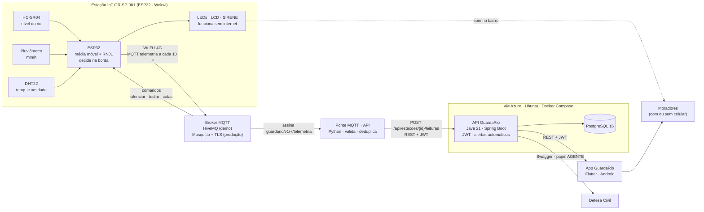
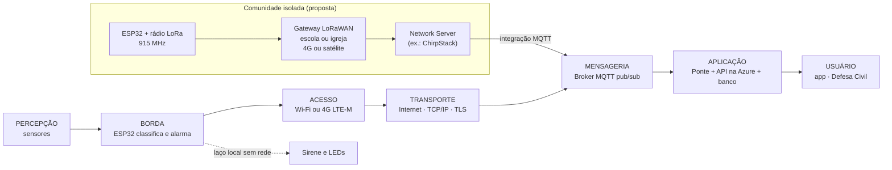
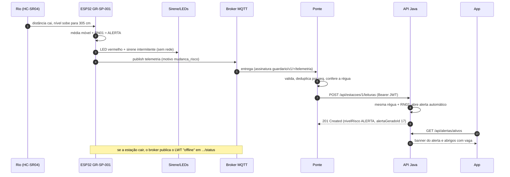
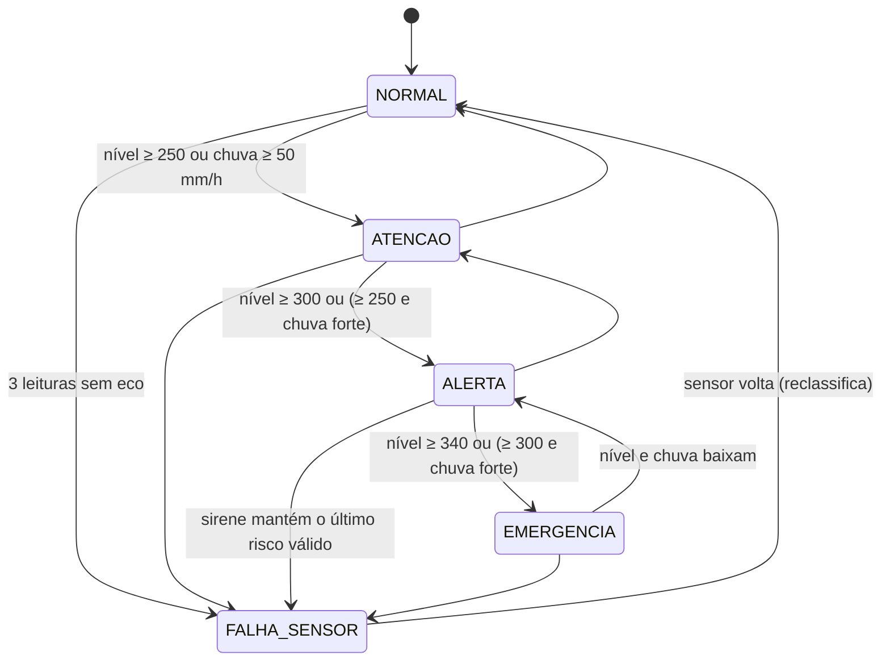

# GuardaRio · Estação IoT de alerta de enchentes

> **O rio avisa antes de subir.** Estação de baixo custo que mede o nível do rio e a chuva, classifica o risco no próprio dispositivo, toca a sirene **mesmo sem internet** e envia a telemetria por MQTT para a API do GuardaRio.

**Global Solution 2026/2 · CitizenTech · FIAP · Análise e Desenvolvimento de Sistemas, 2TDS (turmas de agosto)**
**Disciplina:** Disruptive Architectures: IoT, IoB & Generative IA

| Integrante | RM |
|---|---|
| Henrique Spoltore Moreno Pavão dos Santos | RM568130 |
| Raphael Oliveira Sinelli Mendonça | RM568346 |
| Arthur Lins Belarmino | RM566845 |

**Simulação no Wokwi (pública):** <https://wokwi.com/projects/480501151869376513>
**Vídeo da demonstração:** `https://youtu.be/COLOCAR-O-LINK-AQUI`

---

## Sumário

1. [O problema e a proposta CitizenTech](#1-o-problema-e-a-proposta-citizentech)
2. [O protótipo](#2-o-protótipo)
3. [Componentes e fluxo de comunicação em rede](#3-componentes-e-fluxo-de-comunicação-em-rede)
4. [Diagramas da arquitetura](#4-diagramas-da-arquitetura)
5. [Como executar](#5-como-executar)
6. [Testes, evidências e métricas](#6-testes-evidências-e-métricas)
7. [Justificativas técnicas](#7-justificativas-técnicas)
8. [Limitações](#8-limitações)
9. [Escala e evolução: IoB e IA generativa](#9-escala-e-evolução-iob-e-ia-generativa)
10. [Estrutura do repositório](#10-estrutura-do-repositório)
11. [Onde está cada critério de avaliação](#11-onde-está-cada-critério-de-avaliação)

---

## 1. O problema e a proposta CitizenTech

Enchente não é evento raro no Brasil. Ela se repete todo ano nas mesmas baixadas, e quem mais perde é quem tem menos tempo e menos meios para sair.

| Dado | Fonte |
|---|---|
| Enchentes de 2024 no RS: **478 dos 497 municípios** atingidos, mais de **2,39 milhões de pessoas** afetadas, 182 mortes confirmadas até julho e pico de 538 mil desalojados | Boletins da Defesa Civil do RS (via SBT News e Poder360) |
| **8.270.127 pessoas** moram em áreas de risco de enchente e deslizamento nos 872 municípios monitorados | IBGE e Cemaden, *População em áreas de risco no Brasil* |
| **3.620 alertas** de desastre emitidos pelo Cemaden em 2024, recorde desde 2011 | Governo Federal (via Jornal de Brasília) |
| Um aviso com **24 h de antecedência reduz os danos em até 30%** | Global Commission on Adaptation, citada pela WMO (*Early Warnings for All*) |

### Onde o sistema atual falha (e o que a estação resolve)

| Falha | Resposta da estação GuardaRio |
|---|---|
| **Aviso regional, risco local.** O alerta oficial cobre a cidade ou a bacia; o morador da rua mais baixa não sabe se a água vai chegar à casa dele. | Medição **hiperlocal**: uma estação no ponto do rio que afeta aquele bairro, com cotas próprias daquele ponto. |
| **Sem internet, sem aviso.** Na cheia caem a energia e a rede celular; alerta que depende só de app ou SMS falha na pior hora. | A **decisão é tomada na borda**: o ESP32 classifica o risco e aciona sirene e LEDs sem depender de rede. |
| **Sensor quebrado engana.** Uma leitura "zero" falsa desarmaria o alerta. | Leitura sem eco vira **FALHA DE SENSOR**, nunca "nível zero"; a sirene mantém o último risco válido. |
| **Ninguém sabe se a estação caiu.** | **LWT do MQTT**: o broker publica `offline` sozinho quando a estação some. |

### Cidadão beneficiado

**Dona Cida, 67 anos**, moradora do Jardim Pantanal (zona leste de São Paulo, às margens do Tietê). Mora com o neto e uma cadela, usa um Android simples e não tem carro. Na última cheia só saiu quando a água estava no joelho. Ela precisa de um **aviso cedo e simples** e de uma **sirene que funcione sem internet**. A estação `GR-SP-001` deste protótipo representa o ponto do Tietê que afeta a rua dela.

> Persona construída pelo grupo para orientar o design. O bairro é real e tem histórico de alagamentos; os detalhes pessoais são fictícios.

**ODS atendidos:** 11.5 (reduzir pessoas afetadas por desastres), 13.1 e 13.3 (resiliência e alerta precoce), 9.1 (infraestrutura resiliente), 10.2 (inclusão: a sirene alcança quem não tem smartphone), 3.d (alerta precoce para riscos à saúde).

---

## 2. O protótipo

### 2.1 Componentes e pinagem

| Componente | Pinos (ESP32) | Função e justificativa |
|---|---|---|
| **ESP32 DevKit C V4** (core Arduino) | – | Wi-Fi nativo, **dois núcleos** (um para sensores e alarme, outro para a rede) e baixo custo (≈ R$ 45). Programado em C++ na plataforma Arduino. |
| **Ultrassônico HC-SR04** | TRIG 5, ECHO 18 | Mede a distância até a água: **nível = altura de instalação (400 cm) − distância**. Não encosta na água (não corrói nem entope). Na versão real, o **JSN-SR04T** à prova d'água. No circuito físico, o ECHO (5 V) precisa de **divisor de tensão** para 3,3 V. |
| **Pluviômetro de báscula** (pushbutton, tecla `C`) | GPIO 4, `INPUT_PULLUP` | Cada pulso = **0,2 mm** de chuva, como num pluviômetro real com reed switch. Contagem por **interrupção com debounce**; mm/h numa janela móvel. |
| **DHT22** | GPIO 15 | Temperatura e umidade como contexto da chuva (umidade alta e persistente). |
| **LCD 16x2 I2C** (0x27) | SDA 21, SCL 22 | Mostra nível, chuva, risco, silêncio e estado da rede (`W+`/`M+`) para quem está perto da estação. |
| **LEDs** verde, amarelo e vermelho (330 Ω) | 25, 26, 27 | Semáforo do risco, visível de longe e sem precisar saber ler. |
| **Buzzer** (sirene) | GPIO 13 | Alarme sonoro local: **intermitente em ALERTA**, **rápido e contínuo em EMERGÊNCIA**. No físico, aciona um relé de sirene 12 V. |
| **Botão de teste e silêncio** (tecla `S`) | GPIO 19, `INPUT_PULLUP` | Clique curto: **silencia a sirene por 10 min** (o LED vermelho continua). Segurar 1,5 s: **testa a sirene** por 3 s. |

### 2.2 Régua de risco (RN01, a mesma no ESP32, na API Java e no PL/SQL)

Cotas padrão do ponto GR-SP-001 (configuráveis por comando MQTT e salvas na flash):

| Risco | Condição (nível em cm) | LEDs | Sirene | No sistema |
|---|---|---|---|---|
| **NORMAL** | nível < 250 | verde | desligada | nada |
| **ATENÇÃO** | nível ≥ 250 (cota de atenção) | amarelo | desligada | área em atenção no app |
| **ALERTA** | nível ≥ 300 (cota de alerta) | vermelho | intermitente (500 ms) | alerta automático para a área |
| **EMERGÊNCIA** | nível ≥ 340 (cota de transbordo) | vermelho | rápida e contínua (900/1400 Hz) | alerta de emergência, substitui os menores |

**Agravante de chuva:** com chuva ≥ **50 mm/h** (chuva muito forte), o risco **sobe um nível**, até EMERGÊNCIA. Assim a estação avisa *antes* de o rio responder à chuva.

### 2.3 Lógica embarcada (decisões na borda)

```text
  a cada 2 s                  a cada 10 s ou quando o risco muda
  ┌──────────────┐            ┌──────────────────────────┐
  │ HC-SR04      │──┐         │ monta JSON de telemetria │──► fila FreeRTOS ──► núcleo 0 ──► MQTT
  │ pluviômetro  │──┼─► média móvel (5) ─► classificar(RN01) ─┐
  │ DHT22        │──┘                                         ├─► LEDs + sirene + LCD   (núcleo 1, sem rede)
  └──────────────┘                                            │
  comandos MQTT / botão / Serial ─────────────────────────────┘
```

* **Leitura a cada 2 s e média móvel de 5 amostras**: filtra ondas e ruído do ultrassônico sem atrasar demais a resposta (≈ 10 s de janela).
* **Eco ausente** (timeout de 30 ms do `pulseIn`) ou distância impossível não entram na média. Três falhas seguidas viram **FALHA_SENSOR**: o LCD mostra `FALHA SENSOR`, o LED amarelo pisca e a telemetria vai com `"nivelCm": null`. **Nunca** é enviado nível zero. A sirene continua seguindo o **último risco válido** (*fail-safe*: na dúvida, não desarma).
* **Classificação com a régua RN01** e cotas trocáveis por MQTT, com validação **RN10** (atenção < alerta < transbordo ≤ altura de instalação). As cotas ficam na **flash (Preferences)** e sobrevivem a reinício.
* **Silêncio com segurança:** se o risco **piorar** enquanto a sirene está silenciada, o silêncio é cancelado na hora.
* **Dois núcleos e nenhum `delay` longo:** o `loop()` (núcleo 1) usa `millis()` para sensores, sirene, LEDs, LCD, botão e Serial. A conexão Wi-Fi/MQTT roda numa **tarefa FreeRTOS no núcleo 0**. Se a rede travar numa reconexão, o alarme local **não para**.
* **Store and forward:** a telemetria passa por uma fila de 30 mensagens (≈ 5 min offline). Quando a conexão volta, a fila é enviada. Se encher, descarta a mais antiga.

### 2.4 Comandos de teste pelo Serial Monitor

| Comando | O que faz | Teste |
|---|---|---|
| `wifi off` / `wifi on` | Derruba e religa o Wi-Fi (sem despedida do MQTT, como numa queda real) | T7 |
| `mqtt off` / `mqtt on` | Corta o socket com o broker sem `DISCONNECT`: o broker publica o **LWT** | T8 |
| `falha on` / `falha off` | Simula HC-SR04 sem eco (o Wokwi sempre devolve eco) | T9 |
| `silenciar` · `reativar` · `testar` | Mesmo efeito do botão ou do comando MQTT | T10 |
| `status` | Mostra nível, chuva, risco, rede, tamanho da fila e cotas | – |

---

## 3. Componentes e fluxo de comunicação em rede

### 3.1 Dispositivos e componentes de rede

| Camada | Componente | Papel na rede | Tecnologia / protocolo |
|---|---|---|---|
| Percepção | HC-SR04, pluviômetro, DHT22 | Aquisição dos dados físicos | GPIO, interrupção, protocolo 1-wire do DHT |
| Borda | **ESP32** | Filtra, classifica, aciona o alarme local, publica e assina MQTT | C++/Arduino, FreeRTOS |
| Acesso | **Ponto de acesso Wi-Fi** (área urbana) ou **modem 4G LTE-M** | Liga a estação à internet | IEEE 802.11 b/g/n (2,4 GHz) · LTE-M |
| Acesso (proposta) | **Rádio LoRa 915 MHz + gateway LoRaWAN** (escola, igreja) | Alcance de quilômetros com baixo consumo para comunidades sem 4G | LoRaWAN (faixa ISM 915 MHz, AU915 no Brasil) |
| Transporte | Internet | Leva os pacotes até o broker | TCP/IP; **TLS** na porta 8883 em produção |
| Mensageria | **Broker MQTT** | Publish/subscribe entre estações e servidor, QoS, retain e LWT | HiveMQ público (demo) · Mosquitto na VM Azure (produção) |
| Integração | **Ponte MQTT→API** (`ponte/`) | Assina a telemetria, valida, deduplica e faz POST na API com token | Python, paho-mqtt, HTTP/REST + JWT |
| Aplicação | **API GuardaRio** + PostgreSQL | Regras de negócio, alertas automáticos, abrigos, relatos | Java 21, Spring Boot, VM Azure, Docker |
| Usuário | App GuardaRio, painel da Defesa Civil, **sirene no bairro** | Recebe o alerta | Android, HTTP · som local |

### 3.2 Caminho do dado até o usuário

1. **Sensor → ESP32:** pulso ultrassônico, pulso do pluviômetro (interrupção) e leitura do DHT22.
2. **ESP32 (borda):** média móvel, classificação RN01, **sirene e LEDs na hora** (laço local, sem rede).
3. **ESP32 → ponto de acesso:** Wi-Fi 2,4 GHz (`Wokwi-GUEST` na simulação).
4. **Internet → broker:** MQTT sobre TCP, publicação em `guardario/v1/GR-SP-001/telemetria`.
5. **Broker → ponte:** a ponte assina `guardario/v1/+/telemetria` (o `+` pega todas as estações).
6. **Ponte → API:** `POST /api/estacoes/{id}/leituras` com `Authorization: Bearer <JWT>` de um usuário técnico AGENTE.
7. **API → app:** a API aplica a mesma régua, abre o **alerta automático** (RN02) e o app mostra o banner e os abrigos com vaga.
8. **Nuvem → estação (volta):** comandos em `guardario/v1/GR-SP-001/comandos` (silenciar, testar sirene, novas cotas).

### 3.3 Tópicos MQTT

Padrão: `guardario/v1/<código-da-estação>/<tipo>`. A versão no tópico permite mudar o formato sem quebrar estações antigas; o código da estação permite assinar uma estação (`GR-SP-001`) ou todas (`+`).

| Tópico | Sentido | QoS / retain | Conteúdo |
|---|---|---|---|
| `guardario/v1/GR-SP-001/telemetria` | estação → nuvem | QoS 0 (+ `seq`) | JSON a cada 10 s **e** na hora em que o risco muda |
| `guardario/v1/GR-SP-001/status` | estação → nuvem | QoS 1, **retain** | `online` ao conectar; **LWT `offline`** se a estação cair |
| `guardario/v1/GR-SP-001/comandos` | nuvem → estação | QoS 1 (assinatura) | `{"acao":"silenciar"}`, `{"acao":"reativar"}`, `{"acao":"testar_sirene"}`, `{"acao":"status"}`, `{"acao":"cotas","atencaoCm":250,"alertaCm":300,"transbordoCm":340}` |
| `guardario/v1/GR-SP-001/eventos` | estação → nuvem | QoS 0 | Confirmação de comandos e eventos: `silenciado`, `cotas_rejeitadas`, `falha_sensor`, `sensor_recuperado`… |

**Exemplo de telemetria:**

```json
{"estacao":"GR-SP-001","seq":532,"nivelCm":338,"chuvaMmH":54.0,"temperaturaC":23.8,"umidadePct":91,
 "risco":"EMERGENCIA","sensorOk":true,"sirene":true,"silenciado":false,"tendenciaCmH":40,
 "rssi":-61,"uptimeS":5321,"ts":1794500000,"motivo":"mudanca_risco"}
```

| Campo | Significado |
|---|---|
| `seq` | Número da mensagem. A ponte usa para **detectar perdas** (buracos) e **duplicadas** |
| `nivelCm` | Nível do rio (média móvel). `null` quando o sensor falha |
| `chuvaMmH` | Chuva na janela móvel |
| `risco` | Resultado da régua RN01 na borda (`NORMAL`, `ATENCAO`, `ALERTA`, `EMERGENCIA`, `FALHA_SENSOR`) |
| `tendenciaCmH` | Velocidade de subida do rio (cm/h) nos últimos 5 min |
| `rssi` | Qualidade do sinal Wi-Fi (dBm) |
| `ts` | Hora da medição em UTC (NTP). `0` se a estação ainda não sincronizou o relógio |
| `motivo` | `periodico`, `mudanca_risco` ou `comando_status` |

---

## 4. Diagramas da arquitetura

### Figura 1 · Visão geral da solução



### Figura 4 · Fluxo de comunicação por camadas



### Figura 5 · Sequência de um alerta (o que a demonstração mostra)



### Figura 6 · Estados do risco na estação



---

## 5. Como executar

### 5.1 Estação no Wokwi (navegador, sem instalar nada)

1. Abra o projeto público no Wokwi: <https://wokwi.com/projects/480501151869376513> **ou** crie um projeto novo em <https://wokwi.com/projects/new/esp32> e substitua o conteúdo das abas pelos arquivos da pasta [`firmware/`](firmware/):
   * `sketch.ino`
   * `diagram.json`
   * `libraries.txt` (aba *Library Manager*: PubSubClient, ArduinoJson, LiquidCrystal I2C, DHT sensor library for ESPx)
2. Clique em **▶ Start**. No Serial Monitor aparecem a lista de comandos, `[REDE] MQTT conectado` e as mensagens `[MQTT] {...}`.
3. Interaja:
   * **Nível do rio:** clique no HC-SR04 e mova o controle de distância. Distância 300 cm = nível 100 (NORMAL); 150 = nível 250 (ATENÇÃO); 100 = nível 300 (ALERTA); 60 = nível 340 (EMERGÊNCIA).
   * **Chuva:** clique no botão azul ou aperte a tecla **C** (com o foco no diagrama). Cada pulso vale 0,2 mm; **5 pulsos em 1 minuto ≈ 60 mm/h**.
   * **Temperatura e umidade:** clique no DHT22.
   * **Silenciar / testar sirene:** botão vermelho ou tecla **S** (segurar 1,5 s testa).

### 5.2 Ver as mensagens no HiveMQ (navegador)

1. Abra o cliente web <https://www.hivemq.com/demos/websocket-client/> e clique em **Connect** (broker `broker.hivemq.com`, porta 8884, TLS).
2. **Add New Topic Subscription:** `guardario/v1/GR-SP-001/#` (QoS 1). Aparecem `status`, `telemetria` e `eventos`.
3. Para mandar um comando: tópico `guardario/v1/GR-SP-001/comandos`, mensagem `{"acao":"silenciar"}`, **Publish**.

### 5.3 Ponte MQTT→API (Python 3.10+)

```bash
cd ponte
python -m venv .venv
# Windows: .venv\Scripts\activate    |    Linux/macOS: source .venv/bin/activate
pip install -r requirements.txt
cp .env.example .env        # Windows: copy .env.example .env
```

| Cenário | Como rodar |
|---|---|
| **Só registrar (sem API)** | `MODO=dry-run` no `.env` e `python ponte_mqtt_api.py`. Gera `saida/leituras.csv` e `saida/metricas.json`. |
| **Com a API simulada** (teste local) | Terminal 1: `python api_mock.py`. Terminal 2: no `.env`, `MODO=api`, `API_URL=http://localhost:8080`, `API_SENHA=qualquer` e `python ponte_mqtt_api.py`. |
| **Com a API Java na Azure** (demonstração) | `MODO=api`, `API_URL=http://IP-PUBLICO-DA-VM:8080`, `API_EMAIL`/`API_SENHA` de um usuário **AGENTE**, `ESTACOES=GR-SP-001:<id da estação na API>`. |
| **Sem o Wokwi** | `python simulador_estacao.py` publica uma cheia completa (NORMAL → EMERGÊNCIA). `--estacoes 20` simula 20 estações. |
| **Comandos** | `python comando.py silenciar` · `python comando.py testar_sirene` · `python comando.py cotas 240 290 330` |

### 5.4 Testes automatizados da ponte

```bash
cd ponte
python -m pytest -q
```

---

## 6. Testes, evidências e métricas

### 6.1 Testes funcionais do protótipo (T1 a T10)

O passo a passo detalhado de cada teste, com o que fotografar, está em [`docs/TESTES.md`](docs/TESTES.md). As evidências (prints do Wokwi com LCD, LEDs e Serial Monitor, mais o log das mensagens recebidas pela nuvem) ficam em [`docs/evidencias/`](docs/evidencias/).

Executados em **12/11/2026** no projeto público do Wokwi. O lado da nuvem foi registrado por um assinante MQTT em `guardario/v1/GR-SP-001/#` no broker HiveMQ ([`docs/evidencias/mqtt_log.txt`](docs/evidencias/mqtt_log.txt)), e os comandos da nuvem foram enviados com [`ponte/comando.py`](ponte/comando.py).

> **Calibração observada:** no Wokwi o HC-SR04 lê cerca de 3 cm a mais (300 cm → nível 97). Por isso os testes usam distâncias com folga da cota: 145 cm (nível 254), 95 cm (304) e 55 cm (345).

| # | Procedimento | Resultado esperado | Observado | Evidência | Status |
|---|---|---|---|---|---|
| T1 | HC-SR04 em 300 cm | LED verde, LCD `NORMAL`, telemetria com `"risco":"NORMAL"` | Nível 97 cm, LED verde, LCD `NORMAL W+M+`; `seq 1` `NORMAL` recebida pelo assinante às 13:41:58 | `T1.jpg` | CONCLUÍDO |
| T2 | HC-SR04 em 145 cm | LED amarelo, sem sirene, mensagem imediata | `[RISCO] NORMAL -> ATENCAO (nivel 254 cm)`, `"motivo":"mudanca_risco"`, `"sirene":false` | `T2.jpg` | CONCLUÍDO |
| T3 | HC-SR04 em 95 cm (sem chuva) | LED vermelho e sirene intermitente | `ATENCAO -> ALERTA (nivel 304 cm, chuva 0.0)`, LED vermelho, buzzer com sinal, periódica com `"sirene":true` | `T3.jpg` | CONCLUÍDO |
| T4 | HC-SR04 em 55 cm | Sirene rápida, LCD `EMERGENCIA` | `ALERTA -> EMERGENCIA (nivel 345 cm)`, LCD `EMERGENCIA`, `"sirene":true` | `T4.jpg` | CONCLUÍDO |
| T5 | Nível 254 cm e 5 pulsos rápidos no pluviômetro | Sobe para `ALERTA`; sem chuva volta a `ATENCAO` | `[CHUVA] ... -> 60.0 mm/h` e `ATENCAO -> ALERTA (nivel 254 cm, chuva 60.0)`; ~60 s depois `ALERTA -> ATENCAO (chuva 48.0)` | `T5.jpg` | CONCLUÍDO |
| T6 | Segurar o botão do pluviômetro por ~3 s | Conta **um único pulso** | 1ª execução: **2 pulsos** (falha, ver abaixo). Após a correção: segurado 3,1 s → `[CHUVA] +1 pulso(s) -> 12.0 mm/h` | `T6.jpg`, `T6_falha_antes_da_correcao.jpg` | CONCLUÍDO após correção |
| T7 | Em EMERGÊNCIA, `wifi off`; depois `wifi on` | Sirene continua; fila; reenvio ao religar | Sirene e LED vermelho ativos, LCD `W-M-`, seq 26–29 `na fila`; LWT `offline` às 13:51:22; com `wifi on`, seq 26–29 entregues juntas às 13:52:25, sem buracos | `T7_wifi_off.jpg`, `T7_wifi_on_fila_enviada.jpg` | CONCLUÍDO |
| T8 | `mqtt off`; depois `mqtt on` | Broker publica o LWT `offline`; volta `online` | LWT `{"estado":"offline"}` às 13:52:54; `online` às 13:53:23 e fila (seq 31–32) entregue | `T8.jpg` | CONCLUÍDO |
| T9 | `falha on`; depois `falha off` | `FALHA SENSOR`, `nivelCm:null`, nunca zero | Evento `falha_sensor`, LCD `FALHA SENSOR / VERIFICAR`, `"nivelCm":null`, `"risco":"FALHA_SENSOR"`, sirene mantida (*fail-safe*); `sensor_recuperado` ao desligar | `T9.jpg` | CONCLUÍDO |
| T10 | Em ALERTA, publicar `{"acao":"silenciar"}` | Sirene silenciada, LED continua, `S` no LCD | Comando às 13:49:34 → evento `silenciado` às 13:49:35; `"sirene":false,"silenciado":true`, LCD `ALERTA S`, LED vermelho aceso | `T10.jpg` | CONCLUÍDO |
| T11 | Silenciado, subir para EMERGÊNCIA | Silêncio cancelado | Evento `silencio_cancelado` e `ALERTA -> EMERGENCIA` no mesmo ciclo, `"silenciado":false` | `T11.jpg` | CONCLUÍDO |
| T12 | Cotas 300/250/340; depois 200/260/320 | Rejeita a inválida; aceita a válida | `cotas_rejeitadas` e `status` mostra `cotas=250/300/340`; depois `cotas_atualizadas` (200/260/320) e volta ao padrão (250/300/340) | `T12.jpg` | CONCLUÍDO |

#### Problemas encontrados pelos testes e corrigidos

| Achado | Teste | Causa | Correção |
|---|---|---|---|
| Pressão longa no pluviômetro contava **2 pulsos** | T6 | A interrupção lia o nível do pino; na soltura, se a interrupção atrasasse durante a trepidação, lia LOW e contava pulso falso | A interrupção só marca a hora da borda; o pulso conta quando o sinal fica **estável por 50 ms** na transição HIGH → LOW (`verificarPluviometro()`) |
| Envio periódico duplicado logo após mudança de risco | T2 (1ª execução) | `tTelemetria = millis()` maior que o `agora` do loop; a subtração sem sinal virava um número enorme | `tTelemetria = tLeitura` (mesmo relógio do loop) |
| Campo `sirene` atrasado na mensagem `mudanca_risco` | T3, T5, T11 | A telemetria era montada antes de a sirene ser atualizada no loop | `atualizarSirene()` chamada antes de publicar a mudança |

#### Comportamento observado sob simulação lenta

Quando o simulador cai para menos de ~40% da velocidade real, o broker derruba a estação pelo *keepalive* (contado em tempo real) e ela reconecta sozinha em poucos segundos. Durante essas quedas, nenhuma telemetria foi perdida: na execução principal dos testes, as **41 mensagens (seq 1 a 41) chegaram ao assinante sem buracos e sem duplicadas**, porque a fila guarda as mensagens até a reconexão (conferido por script sobre o `mqtt_log.txt`). Ver [`mqtt_log_reconexao_simulacao_lenta.txt`](docs/evidencias/mqtt_log_reconexao_simulacao_lenta.txt).

### 6.2 Testes automatizados da ponte (executados)

`python -m pytest -q` → **41 testes, todos passando** (`41 passed`).

| Arquivo | O que prova |
|---|---|
| `tests/test_regua.py` | A régua RN01 da ponte dá o mesmo resultado dos testes T1–T5 (inclusive os limites exatos: 249 → NORMAL, 250 → ATENÇÃO; 49,9 mm/h não agrava, 50 agrava) e a RN10 rejeita cotas fora de ordem |
| `tests/test_telemetria.py` | O payload do documento é aceito; JSON inválido, risco desconhecido, valores fora da faixa e `sensorOk:true` sem nível são rejeitados; falha de sensor **nunca** vira nível zero |
| `tests/test_metricas.py` | Cálculo da taxa de entrega por buracos no `seq`, duplicadas, reinício da estação e disponibilidade pelo LWT |
| `tests/test_ponte_integracao.py` | Fluxo completo ponte → API simulada: alerta aberto **uma vez** em ALERTA e substituído em EMERGÊNCIA (RN02); duplicada e falha de sensor não chegam à API; API fora do ar manda a leitura para a fila de reenvio |

### 6.3 Métricas e critérios adotados

A ponte grava `saida/metricas.json` a cada minuto e ao sair:

| Métrica | Como é medida | Critério (meta do piloto) |
|---|---|---|
| **Taxa de entrega** | recebidas ÷ (recebidas + buracos na sequência `seq`) | ≥ 99% com rede estável |
| **Latência estação → ponte** | hora de chegada − `ts` da estação (NTP, resolução de 1 s) | < 2 s |
| **Latência ponte → API** | tempo do `POST /leituras` | < 500 ms |
| **Latência leitura → alerta no app** | da mudança de risco no Serial até o banner no app (cronômetro) | < 15 s |
| **Disponibilidade da estação** | tempo `online` ÷ tempo total, pelo tópico de status e LWT | ≥ 98% |
| **Divergências da régua** | risco da estação ≠ risco recalculado na ponte | 0 |
| **Duplicadas descartadas** | `seq` repetido | todas descartadas |

---

## 7. Justificativas técnicas

| Escolha | Por quê | Alternativa descartada |
|---|---|---|
| **ESP32** | Wi-Fi nativo, dois núcleos (alarme isolado da rede), barato, usado no CP2 e CP3 | Arduino UNO: sem rede, precisaria de shield |
| **Ultrassônico** | Mede sem contato com a água: não corrói, não entope com lixo da cheia; barato | Sensor de pressão submerso: mais caro e sujeito a sujeira |
| **Pluviômetro de báscula** | Padrão de estações meteorológicas; um pulso por 0,2 mm é simples de contar por interrupção | Sensor de gotas: só diz "chove/não chove" |
| **Média móvel de 5** | Ondas, galhos e reflexos geram picos no ultrassônico; 5 amostras de 2 s filtram sem atrasar o alarme | Mediana: melhor contra picos isolados, mas a média é mais simples de explicar e suficiente aqui |
| **Decisão na borda** | Na cheia a rede cai primeiro. A sirene não pode depender da nuvem | Classificar só na API: sem internet, sem alarme |
| **MQTT** | Leve (cabeçalho de 2 bytes), publish/subscribe (a estação não precisa saber quem consome), QoS, **retain** e **LWT** para saber se a estação caiu | HTTP direto da estação para a API: mais pesado, sem LWT e a estação teria que guardar o JWT |
| **Ponte separada da API** | A API Java continua só REST; a ponte isola a mensageria, faz deduplicação, fila de reenvio e conversão de formato | Cliente MQTT dentro da API: acopla a API ao broker |
| **Tópicos `guardario/v1/<estação>/<tipo>`** | Versão no tópico; wildcard `+` para assinar todas as estações; ACL por estação no broker | Um tópico único para tudo: impossível filtrar ou dar permissão por estação |
| **QoS 1 nos comandos e status, QoS 0 + `seq` na telemetria** | Comando perdido é grave; telemetria chega a cada 10 s e a próxima substitui a perdida. O `seq` mede as perdas | QoS 2 em tudo: mais tráfego e a PubSubClient não publica QoS 1/2 |
| **LoRaWAN (proposta)** | Quilômetros de alcance com bateria, sem depender de 4G, para comunidades ribeirinhas | Satélite em cada estação: caro |

---

## 8. Limitações

| Limitação | Impacto | Como seria resolvido |
|---|---|---|
| **O Wokwi não simula água.** O nível é a distância ajustada à mão no HC-SR04 | Não testa espuma, ondas reais nem chuva no sensor | Piloto físico numa caixa d'água e depois numa ponte |
| **HC-SR04 não é à prova d'água** e o ECHO é 5 V | Não serve para campo; no ESP32 real o ECHO precisa de divisor de tensão | **JSN-SR04T** à prova d'água + divisor (ex.: 1 kΩ / 2 kΩ) |
| **O Wokwi sempre devolve eco** | A falha de sensor é simulada pelo comando `falha on` | Remover o fio do ECHO no diagrama também força o timeout real |
| **Broker público sem autenticação e sem TLS** (porta 1883) | Qualquer pessoa pode ler e publicar nos tópicos, inclusive comandos | Mosquitto próprio na VM Azure com **TLS (8883)**, usuário e senha por estação e **ACL** por tópico; comandos assinados |
| **Janela de chuva de 60 s** | Para a demonstração caber em minutos. Em campo, 1 min gera mm/h exagerado com poucas báscula | Janela de 10 a 15 min em produção (constante `JANELA_CHUVA_S`) |
| **Telemetria em QoS 0** (limite da PubSubClient) | Uma mensagem pode se perder | `seq` mede as perdas; a próxima chega em 10 s; mudança de risco é publicada na hora; opção de trocar por `esp-mqtt` com QoS 1 |
| **Fila offline só na RAM** (30 mensagens) | Reinício durante a queda perde a fila | Guardar em LittleFS na flash |
| **Altura de instalação fixa** (400 cm) | Cada ponte tem uma altura diferente | Enviar a altura junto com as cotas no comando de configuração |
| **Latência por `ts` tem resolução de 1 s** e depende de NTP | Latência abaixo de 1 s aparece como 0 | Enviar milissegundos ou medir ida e volta com um comando `ping` |
| **Energia** | No Wokwi não há consumo real | Proposta: painel solar 10 W + bateria; deep sleep entre leituras quando o risco for NORMAL |

### Situações propostas e como a estação responde

| Situação | Resposta |
|---|---|
| A internet cai durante a cheia | A sirene e os LEDs seguem funcionando (núcleo 1 não depende da rede); a telemetria fica na fila e é enviada quando voltar (T7) |
| A energia cai | Proposta de bateria + painel solar. Se a estação apagar, o broker publica o LWT `offline` e a Defesa Civil sabe que aquele ponto está cego (T8) |
| O sensor quebra ou é coberto por lixo | `FALHA_SENSOR`, nunca nível zero; o alarme mantém o último risco válido (T9) |
| Alguém publica um comando falso | Hoje o broker é público (limitação). Em produção: TLS, autenticação e ACL; só a ponte/API pode publicar em `comandos` |
| Chuva fortíssima com o rio ainda baixo | O agravante de chuva sobe o risco um nível antes de o rio responder (T5) |
| Um vizinho silencia a sirene e o rio continua subindo | O silêncio é cancelado sozinho quando o risco piora (T11) |
| Comunidade sem 4G | LoRaWAN até um gateway numa escola ou igreja com 4G ou satélite |
| Morador sem smartphone | Sirene no bairro e integração proposta com o SMS 40199 da Defesa Civil |

---

## 9. Escala e evolução: IoB e IA generativa

### Como escalar para 100 estações

* **Tópicos por código de estação** (`guardario/v1/GR-SP-042/...`): a ponte já assina `+`, então uma estação nova só precisa de um código novo, sem mudar código.
* **Broker gerenciado ou em cluster** (HiveMQ Cloud, EMQX ou Mosquitto com bridge); **shared subscriptions** (`$share/ponte/guardario/v1/+/telemetria`) para rodar várias pontes em paralelo.
* API em containers com mais réplicas e o cache que a API Java já tem.
* Teste: `python simulador_estacao.py --estacoes 100 --intervalo 1` e conferir a taxa de entrega em `saida/metricas.json`.

### IoB (Internet of Behaviors)

Padrões **agregados e anônimos** de resposta aos alertas: quantas pessoas abriram o alerta, quanto tempo levaram até o abrigo, que bairros respondem mais devagar. Isso orienta onde instalar mais sirenes e onde fazer campanha de preparação, **sem identificar pessoas** (LGPD: coleta mínima e anonimização).

### IA generativa

Boletim em linguagem simples gerado a partir das leituras (por exemplo: *"o rio subiu 40 cm em 2 horas; saia agora se você mora na rua X"*), usando o campo `tendenciaCmH` da telemetria, citando os números que sustentam cada frase e **revisado por um agente da Defesa Civil antes de sair**.

### Custo estimado de uma estação real

| Item | R$ |
|---|---|
| ESP32 DevKit | 45 |
| Ultrassônico à prova d'água JSN-SR04T | 60 |
| Pluviômetro de báscula (reed switch) | 120 |
| DHT22, LCD e LEDs | 50 |
| Sirene 12 V com relé | 60 |
| Painel solar 10 W, bateria e controlador | 150 |
| Caixa IP65 e fixação | 60 |
| **Total aproximado** | **≈ 545** |

> Estimativa do grupo com preços de varejo.

---

## 10. Estrutura do repositório

```text
guardario-iot/
├── README.md                    ← este documento
├── firmware/
│   ├── sketch.ino               ← firmware do ESP32, comentado em português
│   ├── diagram.json             ← circuito do Wokwi
│   └── libraries.txt            ← bibliotecas do Wokwi
├── ponte/
│   ├── ponte_mqtt_api.py        ← ponte MQTT → API (principal)
│   ├── regua.py                 ← régua RN01 (igual ao firmware)
│   ├── telemetria.py            ← leitura e validação do JSON
│   ├── metricas.py              ← taxa de entrega, latência, disponibilidade
│   ├── cliente_api.py           ← login JWT e POST de leituras
│   ├── api_mock.py              ← API simulada para testes locais
│   ├── simulador_estacao.py     ← estações virtuais (teste de escala)
│   ├── comando.py               ← envia comandos para a estação
│   ├── requirements.txt
│   ├── .env.example             ← configuração de exemplo, sem credenciais
│   └── tests/                   ← 41 testes automatizados (pytest)
└── docs/
    ├── TESTES.md                ← roteiro detalhado dos testes T1 a T12
    ├── APRESENTACAO.md          ← roteiro da demo e respostas às perguntas
    └── evidencias/              ← prints dos testes
```

---

## 11. Onde está cada critério de avaliação

| Critério | Pts | Onde está |
|---|---|---|
| Identificação do problema e proposta CitizenTech | 10 | [Seção 1](#1-o-problema-e-a-proposta-citizentech) |
| Desenvolvimento do protótipo | 25 | [`firmware/`](firmware/), [seção 2](#2-o-protótipo) e o link público do Wokwi |
| Componentes e fluxo de comunicação em rede | 20 | [Seção 3](#3-componentes-e-fluxo-de-comunicação-em-rede) |
| Diagrama da arquitetura | 15 | [Seção 4](#4-diagramas-da-arquitetura) (Figuras 1, 4, 5 e 6) |
| Testes, evidências e demonstração | 20 | [Seção 6](#6-testes-evidências-e-métricas), [`docs/TESTES.md`](docs/TESTES.md), [`docs/evidencias/`](docs/evidencias/), vídeo |
| Documentação técnica e justificativas | 10 | Seções [2](#2-o-protótipo), [5](#5-como-executar), [7](#7-justificativas-técnicas) e [8](#8-limitações) |

**Bibliotecas:** PubSubClient (Nick O'Leary), ArduinoJson 7 (Benoît Blanchon), LiquidCrystal I2C, DHT sensor library for ESPx (beegee-tokyo), Preferences e WiFi (core Arduino-ESP32) · paho-mqtt 2.1 e requests (Python).

**Referências:** Defesa Civil do RS (via SBT News e Poder360); IBGE/Cemaden, *População em áreas de risco no Brasil*; WMO, *Early Warnings for All*; Nações Unidas Brasil, ODS; Wokwi Docs (ESP32, HC-SR04, DHT22, LCD I2C); OASIS, *MQTT Version 3.1.1*; LoRa Alliance, *LoRaWAN Regional Parameters* (AU915).
